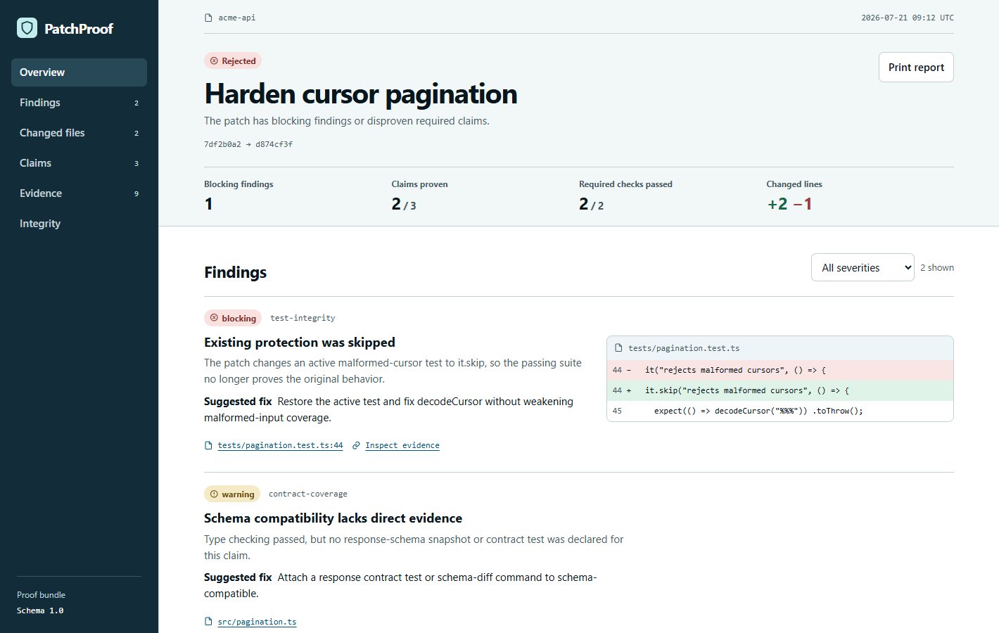
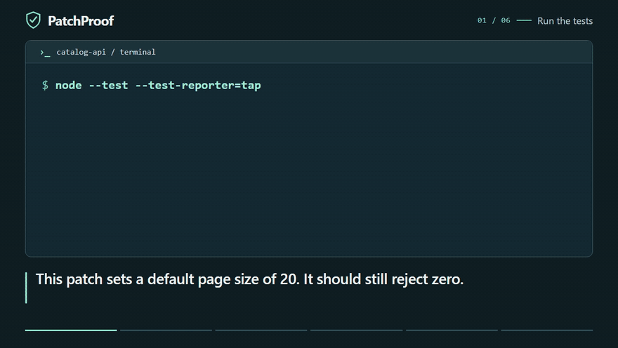

<h1>
  <picture>
    <source media="(prefers-color-scheme: dark)" srcset="docs/assets/brand/patchproof-wordmark-dark.svg">
    
  </picture>
</h1>

**Local verification for AI-written patches.**



PatchProof compares two Git commits, runs the checks defined on the trusted base, and shows the evidence behind each claim in an offline HTML report. Use it to catch a patch that skips a test, changes files outside its scope, or weakens its own verification policy.

[](https://github.com/giancoferrari/patchproof/actions/workflows/ci.yml)
[](https://github.com/giancoferrari/patchproof/actions/workflows/codeql.yml)

[Quickstart](#quickstart) · [37-second walkthrough](#watch-patchproof-catch-a-skipped-test) · [CLI guide](docs/cli-guide.md) · [GitHub Action](docs/cli-guide.md#github-action)

## Watch PatchProof catch a skipped test

A pagination patch should default to 20 when the page size is missing and still reject zero. Both repository checks pass, but the patch skips the zero test. Follow the blocking finding to line 9, then watch the corrected commit pass the same policy.

<details>
<summary>Play the captioned walkthrough (37 seconds)</summary>

[](docs/assets/patchproof-walkthrough.mp4)

</details>

[Download the video (720p MP4, 0.8 MB)](https://raw.githubusercontent.com/giancoferrari/patchproof/main/docs/assets/patchproof-walkthrough.mp4) · [View a sample report screenshot](docs/assets/patchproof-report.png)

**Try a report without installing anything.** [Download the sample HTML report](https://github.com/giancoferrari/patchproof/raw/refs/heads/main/examples/patchproof-report.html) and open the saved file in your browser. This separate example links a blocking finding to a disabled cursor test. You can also [inspect the underlying JSON](examples/demo-proof.json).

## Quickstart

You’ll need Git and Node.js 22.12 or newer to build the current CLI. For the packaged CLI, see the [v0.1.0 installation instructions](docs/cli-guide.md#installation).

**1. Install PatchProof from source.** Run these commands from the directory where you keep development tools.

```sh
git clone https://github.com/giancoferrari/patchproof.git
cd patchproof
npm ci
npm install --global .
patchproof --version
```

**2. Set up the repository you want to review.** From its trusted base branch (here, `main`), initialize PatchProof. Review the commands in `.patchproof/policy.yml` and the claims in `.patchproof/contract.yml` before committing them.

```sh
patchproof init
patchproof doctor
git add .gitignore .patchproof/policy.yml .patchproof/contract.yml
git commit -m "Establish PatchProof verification policy"
```

**3. Verify a committed change.** Switch to your feature branch, commit the implementation and its tests, then run verification from the clean checkout.

```sh
patchproof doctor --base main
patchproof verify --base main --head HEAD
```

Open the HTML file printed next to `report` to inspect the verdict. Its companion JSON file contains the commits, policy, findings, and command results. Both files are saved in `.patchproof/proofs/` by default.

## Read the verdict

| Verdict | What it tells you |
| --- | --- |
| **Verified** | All required commands passed, all claims have passing evidence, and there are no blocking findings. |
| **Rejected** | A blocking finding, a failed required command, or a disproven blocking claim needs attention. |
| **Incomplete** | No blocking failure was found, but a claim or required command still lacks passing evidence. |

A verdict covers the configured checks and claims. Reviewers still decide whether those checks cover the behavior that matters. Repository commands run with the permissions of the process that launched PatchProof. [Read the threat model](docs/threat-model.md).

## Documentation

| If you want to… | Start here |
| --- | --- |
| Choose commands, limit changed paths, or detect weakened tests | [Policies and contracts](docs/policies-and-contracts.md) |
| Automate verification or use the TypeScript API | [CLI and integration guide](docs/cli-guide.md) |
| Compare candidate commits or verify a signed bundle against Git | [Advanced review workflows](docs/advanced-workflows.md) |
| Interpret or integrate proof JSON | [Bundle format](docs/proof-bundle.md) · [JSON Schema](schemas/proof-bundle.schema.json) |
| Draft contract claims with a local model | [Local models](docs/local-models.md) |
| Understand how a verdict is computed | [Architecture](docs/architecture.md) |

The current checkout identifies as `0.2.0`. The packaged GitHub release is [v0.1.0](https://github.com/giancoferrari/patchproof/releases/tag/v0.1.0). See the [changelog](CHANGELOG.md) for features available on `main`.

[Contributing](CONTRIBUTING.md) · [Roadmap](ROADMAP.md) · [Security policy](SECURITY.md) · [MIT license](LICENSE)
